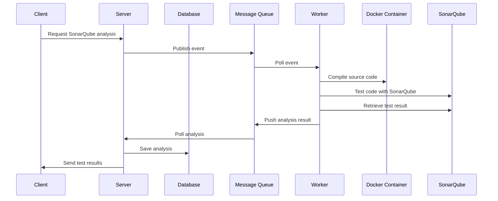

# Java Code Review Application

A collaborative code review platform that supports two kinds of reviews. Developers create projects, invite teammates, and submit code for review:

- **Sonar review**: the code is executed in an isolated Docker container, analyzed with **SonarQube**, and checked against the project's quality gate (bugs, vulnerabilities, code smells, coverage). The analysis runs asynchronously in a background worker.
- **Human review**: reviewers read the submitted code files and leave comments on them.


---

## Table of Contents

- [Features](#features)
- [Architecture](#architecture)
- [Review Types](#review-types)
- [Database Design](#database-design)
- [Tech Stack](#tech-stack)
- [Project Structure](#project-structure)
- [Getting Started](#getting-started)
- [Configuration](#configuration)
- [Services and Ports](#services-and-ports)
- [How a Sonar Review Works](#how-a-sonar-review-works)
- [Security Notes](#security-notes)
- [Roadmap](#roadmap)
- [License](#license)

---

## Features

- **Projects and teams**: create projects, add members, and invite users by token-based invitations with an expiry date and status.
- **Code submissions**: upload source files with a title, description, labels, and a review type (**Sonar** or **Human**).
- **Sonar reviews**: the code is executed in a Docker container and scanned with SonarQube by a background worker, so the API stays responsive.
- **Quality gates per project**: configure maximum allowed bugs, vulnerabilities, and code smells, plus a minimum coverage, and enable or disable the checks.
Sonar reviews are validated against these thresholds.
- **Detailed results**: aggregate counts per execution plus individual issues with severity, file name, line number, and message.
- **Human reviews**: assign reviewers to a submission and discuss the code with line-level comments on the code files.
- **Notifications**: users are notified about invitations and review activity.
- **One-command setup**: the entire stack runs with Docker Compose.

## Architecture


The system is split into a synchronous API and an asynchronous analysis pipeline connected by a message queue:

| Component | Responsibility |
|-----------|----------------|
| **Client** | Web UI used to submit code, request analyses, and view results. |
| **Server** (`CodeReviewApp`) | REST API. Handles users, projects, and submissions, publishes analysis requests, consumes results, and persists them. |
| **Message Queue** (RabbitMQ) | Decouples the server from the worker. Carries analysis requests and analysis results. |
| **Worker** (`WorkerApp`) | Consumes analysis requests, compiles the submitted source inside a Docker container, runs the SonarQube scan, retrieves the report, and publishes the result. |
| **Docker Container** | Isolated environment used to compile and analyze untrusted source code. |
| **SonarQube** | Static analysis engine producing bugs, vulnerabilities, code smells, and coverage. |
| **Database** (PostgreSQL) | Stores users, projects, submissions, executions, issues, comments, and notifications. |

## Review Types

Each submission has a `review_type` that decides how it is reviewed.

| | **Sonar review** | **Human review** |
|---|---|---|
| **How it works** | The code is executed in a Docker container and analyzed with SonarQube. | Reviewers read the code files in the app. |
| **Outcome** | Checked against the project's quality gate only (max bugs, vulnerabilities, code smells, min coverage). | Feedback through comments on the code files. |
| **Runs where** | Asynchronously in the worker, through the message queue. | Directly in the server, no worker involved. |
| **Data used** | `submission_execution`, `review_results`, `issues`, `project_settings` | `review_assignees`, `comments` |

## Database Design


| Domain | Tables |
|--------|--------|
| **Users and access** | `users`, `project_members`, `invitation`, `notifications` |
| **Projects** | `project`, `project_settings` |
| **Submissions** | `submission`, `code`, `labels`, `submission_labels` |
| **Analysis** | `submission_execution`, `review_results`, `issues` |
| **Human review** | `review_assignees`, `comments` |

Key relationships:

- A `project` has many members (`project_members`), one `project_settings` row (quality thresholds), many `submission`s, and many `invitation`s.
- A `submission` belongs to a project and a submitter (`users`) and has a `review_type` (Sonar or Human). It has many `code` files, `issues`, `comments`, `review_assignees`, and `submission_execution`s, and is tagged through `submission_labels`.
- Each `submission_execution` records the status, error message, and timing of one analysis run and has many `review_results` (bugs, vulnerabilities, code smells, coverage).
- An `invitation` links a sender and a receiver (both `users`) to a `project` and is identified by a unique `token`.

## Tech Stack

| Layer | Technology |
|-------|------------|
| Backend API | Java (`CodeReviewApp`) |
| Analysis worker | Java (`WorkerApp`) |
| Frontend | Web SPA (`Front/my-app`) served by a container on port 80 |
| Database | PostgreSQL 16 |
| Messaging | RabbitMQ 3 (management plugin) |
| Static analysis | SonarQube Community |
| Sandboxing | Docker (worker talks to the Docker daemon through the host socket) |
| Orchestration | Docker Compose |
| CI | GitHub Actions (`.github/workflows`) |

## Project Structure

```
.
├── .github/workflows/     # CI pipelines
├── .vscode/               # Editor settings
├── Analyzer/              # Analysis tooling used inside the sandbox containers
├── CodeReviewApp/         # Backend API (server)
│   └── submissions/       # Uploaded code (bind-mounted into the container)
├── WorkerApp/             # Background worker that runs the analysis
│   └── workspaces/        # Temporary workspaces for each analysis
├── Front/my-app/          # Frontend client
├── docker-compose.yml     # Full stack definition
└── docs/                  # Architecture and ERD diagrams
```

## Getting Started

### Prerequisites

- [Docker](https://docs.docker.com/get-docker/) and Docker Compose v2
- Around 4 GB of free RAM (SonarQube is memory hungry)


### 1. Clone the repository

```bash
git clone https://github.com/ahmedgarci/JavaCodeReviewApplication.git
cd JavaCodeReviewApplication
```

### 2. Start the infrastructure first

```bash
docker compose up -d sonarqube rabbitmq code-review-database
```

### 3. Generate a SonarQube token

The worker authenticates to SonarQube with a token, so you need to create your own:

1. Open <http://localhost:9090> and log in (default credentials are `admin` / `admin`; you will be asked to change the password).
2. Go to **My Account → Security → Generate Tokens** and create a token.
3. Put it in the `SONAR_ANALYZER_TOKEN` variable of the `worker` service (see [Configuration](#configuration)).

### 4. Start the application

```bash
docker compose up -d --build
```

### 5. Open the app

| Service | URL |
|---------|-----|
| Web client | <http://localhost:5173> |
| Backend API | <http://localhost:8081> |
| SonarQube | <http://localhost:9090> |
| RabbitMQ management | <http://localhost:15672> (`guest` / `guest`) |

### Stopping

```bash
docker compose down        # keep data
docker compose down -v     # also delete volumes (database, SonarQube, RabbitMQ)
```

## Configuration

All configuration is passed through environment variables in `docker-compose.yml`.

### `code-review` (server)

| Variable | Description | Default in compose |
|----------|-------------|--------------------|
| `DB_URL` | JDBC URL of PostgreSQL | `jdbc:postgresql://code-review-database:5432/code_review_db` |
| `DB_USERNAME` / `DB_PASSWORD` | Database credentials | `ahmed` / `ahmed` |
| `RABBIT_MQ_HOST` / `RABBIT_MQ_PORT` | RabbitMQ address | `rabbitmq` / `5672` |
| `RABBIT_MQ_USERNAME` / `RABBIT_MQ_PASSWORD` | RabbitMQ credentials | `guest` / `guest` |
| `SERVER_PORT` | API port | `8081` |
| `FRONT_URL` | Allowed frontend origin | `http://client:80` |

### `worker`

| Variable | Description | Default in compose |
|----------|-------------|--------------------|
| `RABBIT_MQ_HOST` / `RABBIT_MQ_PORT` | RabbitMQ address | `rabbitmq` / `5672` |
| `RABBIT_MQ_USERNAME` / `RABBIT_MQ_PASSWORD` | RabbitMQ credentials | `guest` / `guest` |
| `SONAR_ANALYZER_HOST` | SonarQube URL (internal network) | `http://sonarqube:9000` |
| `SONAR_ANALYZER_TOKEN` | SonarQube user token | **set your own** |
| `SONAR_ANALYZER_NETWORK` | Docker network joined by analysis containers | `code-review-network` |
| `SERVER_PORT` | Worker port | `8888` |

> For anything beyond local development, move secrets into a `.env` file (git-ignored) and reference them with `${VARIABLE}` in the compose file.

## Services and Ports

| Container | Image / Build | Host port |
|-----------|---------------|-----------|
| `client-app` | `./Front/my-app` | `5173` → 80 |
| `code-review-container` | `./CodeReviewApp` | `8081` |
| `worker-service` | `./WorkerApp` | none (internal) |
| `postgres` | `postgres:16` | none (internal) |
| `rabbitmq` | `rabbitmq:3-management` | `5672`, `15672` |
| `sonarqube` | `sonarqube:community` | `9090` → 9000 |

Two Docker networks are used: `code-review-network` for the application services and `sonar-analysis-network` for the SonarQube analysis traffic.

## How a Sonar Review Works

This pipeline applies to submissions with the **Sonar** review type. Human reviews are handled directly by the server and do not go through the queue or the worker.



1. The client asks the server to analyze a submission.
2. The server publishes an analysis event to RabbitMQ and returns immediately.
3. The worker picks up the event, compiles the source inside a Docker container, and runs the SonarQube scan.
4. The worker retrieves the report from SonarQube and pushes the result back to the queue.
5. The server consumes the result, stores it (`submission_execution`, `review_results`, `issues`), and sends the results to the client.
6. The results are checked against the project's quality gate in `project_settings`.

## Security Notes

- The worker mounts `/var/run/docker.sock`, which gives it control over the host's Docker daemon. This is required to spawn analysis containers, but it should only be used in trusted environments.
- Default credentials (`ahmed/ahmed`, `guest/guest`) are for local development only. Change them before any real deployment.
- Never commit a SonarQube token. If one was committed previously, **revoke it in SonarQube and generate a new one**.


## License

No license has been specified yet. Add a `LICENSE` file (for example MIT) to define how others may use this project.
